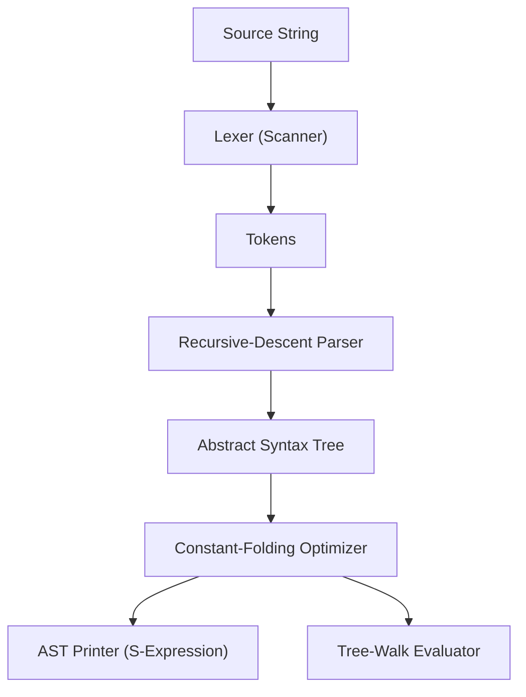

# lexi-byte

`lexi-byte` is a lightweight arithmetic expression compiler front-end, constant-folding abstract syntax tree (AST) optimizer, and tree-walk evaluator written in C++17.

Despite the name, the project does not generate bytecode or include a virtual machine. It focuses strictly on parsing expressions into an AST, performing compile-time constant reduction, printing the simplified tree in prefix S-expression notation, and computing the result using standard 64-bit integer arithmetic.

---

## Architecture & Pipeline

The compilation and evaluation pipeline consists of four stages:



1. **Lexer**: Scans input into tokens (`TokenKind::Number`, `Plus`, `Minus`, `Star`, `Slash`, `LParen`, `RParen`, `End`) while tracking character offsets.
2. **Parser**: Constructs a binary AST using recursive descent. Unary minus (`-x`) is desugared to `(0 - x)`.
3. **Optimizer**: Post-order tree walk that folds computable numeric subtrees at compile time. If a division by zero (`X / 0`) is detected during optimization, folding is bypassed so the runtime evaluator can report it.
4. **Printer & Evaluator**: Serializes the AST to prefix notation (e.g., `(+ 2 3)`) and evaluates the tree to compute the final integer result.

---

## Grammar & Operator Precedence

### Formal Grammar (EBNF)

```ebnf
expression := term (('+' | '-') term)*
term       := factor (('*' | '/') factor)*
factor     := NUMBER | '(' expression ')' | '-' factor
```

### Precedence

| Operator | Associativity | Description |
| :--- | :--- | :--- |
| `( ... )` | None | Grouping (highest precedence) |
| `-` (unary) | Right | Negation (desugared to `0 - factor`) |
| `*`, `/` | Left | Multiplication and integer division |
| `+`, `-` | Left | Addition and subtraction (lowest precedence) |

---

## Building

### Requirements

- A C++17 compliant compiler (GCC 7+, Clang 5+, MSVC 2017+)
- CMake 3.16 or newer

### Build Instructions

```bash
cmake -B build -S .
cmake --build build
```

The resulting executable is generated at `build/lexi-byte`.

---

## Usage

### 1. Command-Line Arguments

Expressions can be passed directly as arguments:

```bash
./build/lexi-byte "(2 + 3) * 4"
# Output:
# Optimized AST: 20
# Result: 20
```

Unquoted arguments are joined with spaces automatically (be mindful of shell-escaped characters such as `*` and `(`):

```bash
./build/lexi-byte 2 + 3 \* 4
# Output:
# Optimized AST: 14
# Result: 14
```

### 2. Interactive Mode

Running without arguments prompts for input via standard input:

```bash
$ ./build/lexi-byte
Expression: 10 + 20 * 3
Optimized AST: 70
Result: 70
```

### 3. Piped Input

When piping input into the executable, `main()` prints `Expression: ` before reading from `std::cin` because it does not check if stdin is a terminal:

```bash
$ echo "42 * (10 - 2)" | ./build/lexi-byte
Expression: Optimized AST: 336
Result: 336
```

### 4. Running the Test Suite

Pass `--test` to run the 7 built-in test cases in `src/main.cpp`:

```bash
./build/lexi-byte --test
```

Output:
```text
[PASS] 2 + 3 * 4
[PASS] (2 + 3) * 4
[PASS] 2 * 3 + 4
[PASS] -5 + 8
[PASS] (2 + 3) * (4 + 1)
[PASS] Error detected: 2 + * 3
[PASS] Error detected: 1 / 0
7 tests passed.
```

---

## Integer Semantics & Overflow Limits

The evaluator stores values in signed 64-bit integers (`long long`). Be aware of the following edge cases:

- **Literal Parsing vs. Unary Minus**: Numeric literals are parsed using `std::stoll` on the positive digit token before unary negation is applied. Because `LLONG_MAX` is `9223372036854775807`, the literal `9223372036854775808` exceeds the range of `std::stoll`. Consequently, the minimum signed 64-bit integer (`-9223372036854775808`) cannot be parsed as a direct literal and produces an `Integer literal out of range` error.
- **Unchecked Arithmetic Overflow**: While `std::stoll` guards against oversized literal tokens, arithmetic operations (`+`, `-`, `*`) do not perform overflow checks. Operations that exceed 64-bit limits wrap according to standard two's-complement arithmetic on most platforms (C++ undefined behavior).
- **Division Overflow**: Dividing `LLONG_MIN` by `-1` (`(-9223372036854775807 - 1) / -1`) is not guarded and will trigger a hardware division exception (`SIGFPE` on x86 architectures).

---

## Known Limitations

- **No Bytecode VM**: Despite the project name, there is no bytecode emission or virtual machine; evaluation is performed directly on the AST.
- **Integers Only**: Floating-point numbers (`3.14`) and exponents are not supported.
- **No Variables or Identifiers**: Expressions cannot store state or reference named variables.
- **Unary Plus**: Unary `+` is not supported (e.g., `+5` will fail parsing).
- **Missing Operators**: Modulo (`%`) and bitwise operators are not implemented.

---

## Project Structure

```
lexi-byte/
├── .gitignore         # Build and editor artifact exclusions
├── CMakeLists.txt     # CMake build configuration
├── LICENSE.md         # MIT License
├── README.md          # Project documentation
└── src/
    └── main.cpp       # Lexer, parser, optimizer, and evaluator
```

---

## License

This project is licensed under the MIT License - see [LICENSE.md](LICENSE.md) for details.
