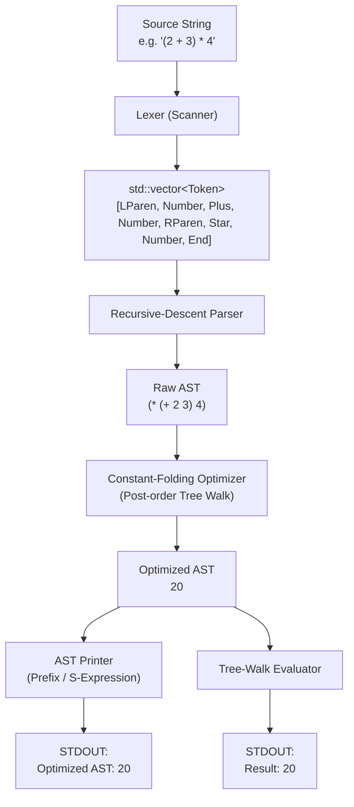

# lexi-byte

`lexi-byte` is a lightweight arithmetic expression compiler front-end, abstract syntax tree (AST) optimizer, and tree-walk evaluator implemented in modern C++17.

Despite the name suggesting bytecode execution, the project in its current state focuses on the front-end and middle-end pipeline: tokenizing, recursive-descent parsing, AST construction, compile-time constant folding, S-expression serialization, and tree-walk evaluation. It contains zero external dependencies beyond the C++ standard library.

---

## Table of Contents

- [Overview](#overview)
- [Pipeline Architecture](#pipeline-architecture)
- [Grammar & Operator Precedence](#grammar--operator-precedence)
- [Components](#components)
  - [1. Lexer (Scanner)](#1-lexer-scanner)
  - [2. AST (Abstract Syntax Tree)](#2-ast-abstract-syntax-tree)
  - [3. Recursive-Descent Parser](#3-recursive-descent-parser)
  - [4. Constant-Folding Optimizer](#4-constant-folding-optimizer)
  - [5. S-Expression AST Printer](#5-s-expression-ast-printer)
  - [6. Tree-Walk Evaluator](#6-tree-walk-evaluator)
- [Step-by-Step Compilation Example](#step-by-step-compilation-example)
- [Project Structure](#project-structure)
- [Requirements](#requirements)
- [Building](#building)
- [Usage](#usage)
  - [Command-Line Arguments](#command-line-arguments)
  - [Interactive Mode](#interactive-mode)
  - [Standard Input (Piped)](#standard-input-piped)
  - [Running the Built-in Test Suite](#running-the-built-in-test-suite)
- [Diagnostics & Error Handling](#diagnostics--error-handling)
- [Implementation Details](#implementation-details)
- [Current Limitations & Roadmap](#current-limitations--roadmap)
- [License](#license)

---

## Overview

`lexi-byte` takes an arithmetic expression string as input, validates its lexical and syntactic structure, optimizes the resulting syntax tree using constant folding, prints the simplified AST in prefix S-expression notation, and computes the final integer result.

### Core Characteristics

- **Zero External Dependencies**: Implemented using standard C++17 headers (`<cctype>`, `<iostream>`, `<memory>`, `<stdexcept>`, `<string>`, `<vector>`).
- **Strict Parsing**: Left-associative binary operators, grouping via parentheses, and unary negation support.
- **Accurate Error Reporting**: Syntax and lexing errors report exact 0-indexed character offsets.
- **Compile-Time Reduction**: Pure constant expressions collapse into single literal nodes prior to evaluation.
- **Division-by-Zero Safety**: Division by zero is detected both in the constant folder (preserved so as not to crash the optimizer) and in the runtime evaluator.

---

## Pipeline Architecture

The processing flow from raw source string to final output follows standard compiler design stages:



---

## Grammar & Operator Precedence

### Formal Grammar (EBNF)

```ebnf
expression := term (('+' | '-') term)*
term       := factor (('*' | '/') factor)*
factor     := NUMBER | '(' expression ')' | '-' factor
```

### Precedence and Associativity Table

| Precedence | Operator | Description | Associativity | Example |
| :--- | :--- | :--- | :--- | :--- |
| **1 (Highest)** | `( ... )` | Parenthesized expression | N/A | `(2 + 3)` |
| **2** | `-` | Unary negation | Right | `-5`, `--5` |
| **3** | `*`, `/` | Multiplication, Integer division | Left | `10 / 2 * 3` -> `(10 / 2) * 3` |
| **4 (Lowest)** | `+`, `-` | Addition, Subtraction | Left | `10 - 3 + 2` -> `(10 - 3) + 2` |

---

## Components

The entire implementation lives inside [`src/main.cpp`](src/main.cpp), structured into clear functional sections:

### 1. Lexer (Scanner)
- Class: `Lexer`
- Iterates over the input string character by character.
- Skips ASCII whitespace (`std::isspace`).
- Scans contiguous digit sequences `[0-9]+` as `TokenKind::Number`.
- Converts operator and delimiter characters (`+`, `-`, `*`, `/`, `(`, `)`) to their corresponding `TokenKind`.
- Appends a terminating `TokenKind::End` token with the string length as its offset.
- Emits detailed errors (`Invalid character at position <pos>`) when an unexpected character is encountered.

### 2. AST (Abstract Syntax Tree)
- Struct: `Node`, managed via `using NodePtr = std::unique_ptr<Node>;`
- Represents either:
  - A numeric leaf node (`isNumber == true`), storing a 64-bit signed integer (`long long value`).
  - A binary operator node (`isNumber == false`), storing the operator character (`char op`) and two child subtrees (`std::unique_ptr<Node> left`, `std::unique_ptr<Node> right`).
- Factory helpers: `number(value)` and `binary(op, lhs, rhs)`.

### 3. Recursive-Descent Parser
- Class: `Parser`
- Implements predictive top-down parsing following the grammar rules.
- Left-associative chains (`+`, `-`, `*`, `/`) are parsed iteratively in `expression()` and `term()` loops to generate left-skewed trees without unnecessary recursion overhead.
- Unary negation is handled in `factor()` by desugaring `-X` into a binary subtraction `(0 - X)`.
- Validates that the full token stream is consumed up to `TokenKind::End`.
- Enforces 64-bit integer limits during token conversion using `std::stoll`, reporting `Integer literal out of range` on overflow.

### 4. Constant-Folding Optimizer
- Function: `NodePtr optimize(NodePtr node)`
- Recursively performs a bottom-up (post-order) traversal of the AST.
- If both left and right subtrees evaluate to numeric literals:
  - Computes the result at compile time via `applyOperator(node->op, a, b)`.
  - Replaces the binary operation node with a single folded `NodeKind::Number` node.
- **Safety check**: If a division by zero (`node->op == '/' && b == 0`) is encountered during folding, the node is **not** folded; it remains in the tree as `(/ a 0)` so that the division-by-zero runtime error can be caught and reported predictably during evaluation.

### 5. S-Expression AST Printer
- Function: `void printAST(const Node& node)`
- Serializes the AST to standard output using Lisp-style S-expressions:
  - Numeric nodes print their raw integer values: `42`
  - Binary operator nodes print in prefix form: `(<op> <left> <right>)`
  - Example: `1 + 2 * 3` prints as `(+ 1 (* 2 3))` (before folding) or `7` (after folding).

### 6. Tree-Walk Evaluator
- Function: `long long evaluate(const Node& node)`
- Evaluates any remaining AST nodes recursively.
- Applies operators on 64-bit signed integers (`long long`).
- Throws `std::runtime_error("Division by zero")` when dividing by 0.

---

## Step-by-Step Compilation Example

### Example 1: Fully Foldable Expression `(2 + 3) * 4`

1. **Input**: `"(2 + 3) * 4"`
2. **Lexing**:
   ```
   [LParen, Number("2"), Plus, Number("3"), RParen, Star, Number("4"), End]
   ```
3. **Parsed AST**:
   ```
          *
         / \
        +   4
       / \
      2   3
   ```
4. **Optimization Pass**:
   - Post-order traversal reaches `+`: left is `2`, right is `3` -> folds to `5`.
   - Node becomes `(* 5 4)`: left is `5`, right is `4` -> folds to `20`.
5. **Program Output**:
   ```text
   Optimized AST: 20
   Result: 20
   ```

### Example 2: Partial Folding with Error Preservation `(+ 6 (/ 10 (4 - 4)))`

If you input `"(2 * 3) + (10 / (4 - 4))"`:
- `2 * 3` folds to `6`.
- `4 - 4` folds to `0`.
- `10 / 0` detects division by zero; folding is bypassed to preserve the runtime diagnostic.
- The parent `+` cannot fold because its right child is not a number.
- **Program Output**:
  ```text
  Optimized AST: (+ 6 (/ 10 0))
  Result: Error: Division by zero
  ```

---

## Project Structure

```
lexi-byte/
├── CMakeLists.txt     # CMake build configuration (requires C++17)
├── README.md          # Project documentation
└── src/
    └── main.cpp       # Self-contained implementation: lexer, parser, AST, optimizer, evaluator
```

---

## Requirements

- **C++ Compiler**: Any modern compiler supporting C++17:
  - GCC 7.0+
  - Clang 5.0+
  - MSVC 2017 (v141)+
- **Build System**: CMake 3.16 or newer.

---

## Building

### Standard Build

```bash
# Generate build configuration in ./build directory
cmake -B build -S .

# Build executable
cmake --build build
```

This compiles `src/main.cpp` with standard warning flags (`-Wall -Wextra -Wpedantic`) and produces the binary at `build/lexi-byte`.

### Debug Build

To compile with debugging symbols and without compiler-level optimizations:

```bash
cmake -B build -S . -DCMAKE_BUILD_TYPE=Debug
cmake --build build
```

### Release Build

To compile with full optimizations:

```bash
cmake -B build -S . -DCMAKE_BUILD_TYPE=Release
cmake --build build
```

---

## Usage

The executable supports three modes of operation:

### 1. Command-Line Arguments

Pass the expression directly as arguments. Arguments can be enclosed in quotes or passed space-separated:

```bash
./build/lexi-byte "2 + 3 * 4"
# Output:
# Optimized AST: 14
# Result: 14

./build/lexi-byte "(100 - 20) / 4"
# Output:
# Optimized AST: 20
# Result: 20
```

Unquoted arguments are automatically joined with spaces by the program:

```bash
./build/lexi-byte 10 + 20 \* 3
# Output:
# Optimized AST: 70
# Result: 70
```
*(Note: Shell metacharacters like `*` or `(` may need escaping in your terminal if not enclosed in quotes).*

### 2. Interactive Mode

If executed without arguments, `lexi-byte` prompts for an expression via standard input:

```bash
$ ./build/lexi-byte
Expression: -15 + 3 * (8 - 2)
Optimized AST: 3
Result: 3
```

### 3. Standard Input (Piped)

You can pipe expressions directly into `lexi-byte`:

```bash
echo "42 * (10 - 2)" | ./build/lexi-byte
# Output:
# Expression: Optimized AST: 336
# Result: 336
```

### 4. Running the Built-in Test Suite

Run the binary with the `--test` flag:

```bash
./build/lexi-byte --test
```

Output:
```text
[PASS] 2 + 3 * 4
[PASS] (2 + 3) * 4
[PASS] 2 * 3 + 4
[PASS] -5 + 8
[PASS] (2 + 3) * (4 + 1)
[PASS] Error detected: 2 + * 3
[PASS] Error detected: 1 / 0
7 tests passed.
```

---

## Diagnostics & Error Handling

All errors throw `std::runtime_error` and are intercepted in `main()`, printing to `std::cerr` and returning exit code `1`.

| Error Type | Example Input | Error Message |
| :--- | :--- | :--- |
| **Unrecognized character** | `2 + @ 3` | `Error: Invalid character at position 4` |
| **Missing closing parenthesis** | `(2 + 3` | `Error: Expected ')' at position 6` |
| **Missing factor / malformed operator** | `2 + * 3` | `Error: Expected a number or '(' at position 4` |
| **Trailing unexpected tokens** | `2 + 3 4` | `Error: Unexpected token '4' at position 6` |
| **Integer literal overflow** | `999999999999999999999` | `Error: Integer literal out of range` |
| **Division by zero** | `10 / 0` | `Error: Division by zero` |

---

## Implementation Details

### Unary Minus Desugaring
Rather than introducing a dedicated unary AST node, unary negation is converted during parsing to a binary subtraction where the left child is zero:
```cpp
if (match(TokenKind::Minus)) {
    return binary('-', number(0), factor());
}
```
For example, `-5` creates the tree `(- 0 5)`, which the constant folder then folds to `-5`.

### Safe Constant Folding on Division
In `optimize()`:
```cpp
// Preserve division by zero for evaluation to report.
if (node->op == '/' && b == 0) return node;
```
If an expression contains `X / 0`, the optimizer does not throw or abort prematurely. It leaves the subtree intact so that `printAST` can still inspect the tree and `evaluate` triggers the runtime error uniformly.

### Integer Semantics
Calculations are performed on signed 64-bit integers (`long long`). Division uses standard C++ truncation towards zero (matching ISO C++ behavior for integer `/`).

---

## Current Limitations & Roadmap

To keep documentation accurate and transparent, here are the current boundaries of the implementation:

- **No Bytecode VM Yet**: Despite the repository name `lexi-byte`, there is currently no bytecode generator, stack virtual machine, or bytecode disassembly. Execution is done via AST evaluation.
- **Integer Only**: Floating point numbers (`1.5`, `3.14`) and scientific notation are not supported.
- **No Variables or Identifiers**: There is no symbol table, environment, or variable assignment (`x = 5`).
- **No Bitwise or Modulo Operators**: `%`, `^`, `&`, `|`, and `<<` / `>>` are not implemented.
- **Unary Plus**: While unary minus (`-5`) is supported, unary plus (`+5`) is treated as a syntax error unless written as a binary addition.
- **Signed Overflow**: Arithmetic operations rely on standard native C++ `long long` operations without automatic promotion to arbitrary-precision BigInts.

### Roadmap / Future Directions

1. **Bytecode Generation**: Emit compact bytecode instructions (`PUSH`, `ADD`, `SUB`, `MUL`, `DIV`, `NEG`) from the optimized AST.
2. **Stack Virtual Machine**: Add a lightweight stack-based VM to execute the generated bytecode.
3. **Floating-Point Arithmetic**: Support `double` literals and operations.
4. **Variable Assignment & Scopes**: Introduce identifiers and an environment map.
5. **Interactive REPL**: Add multi-line input and command history support.

---

## License

This project is open-source. Refer to the repository root for license details (or MIT License if none specified).

